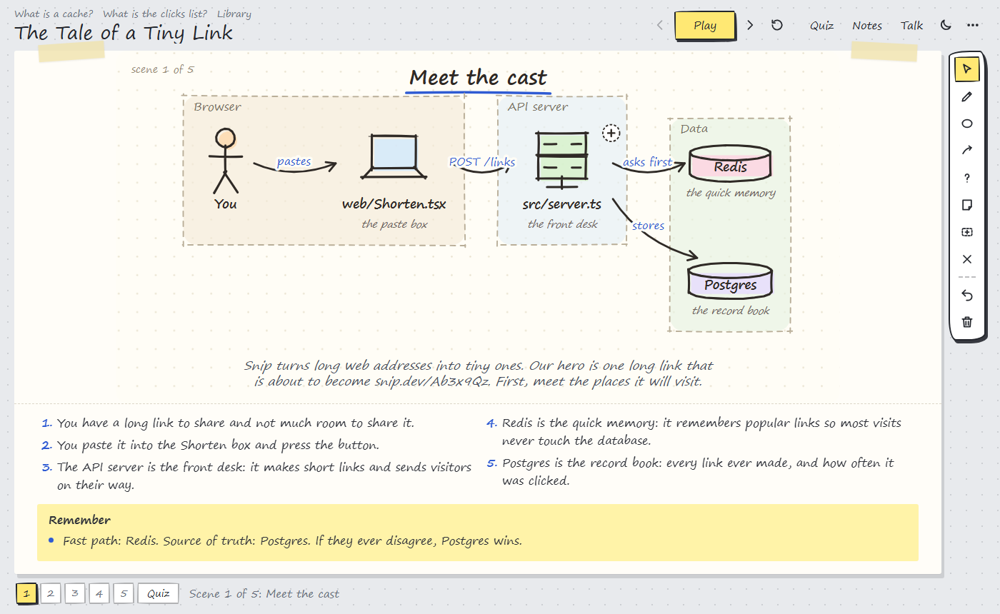
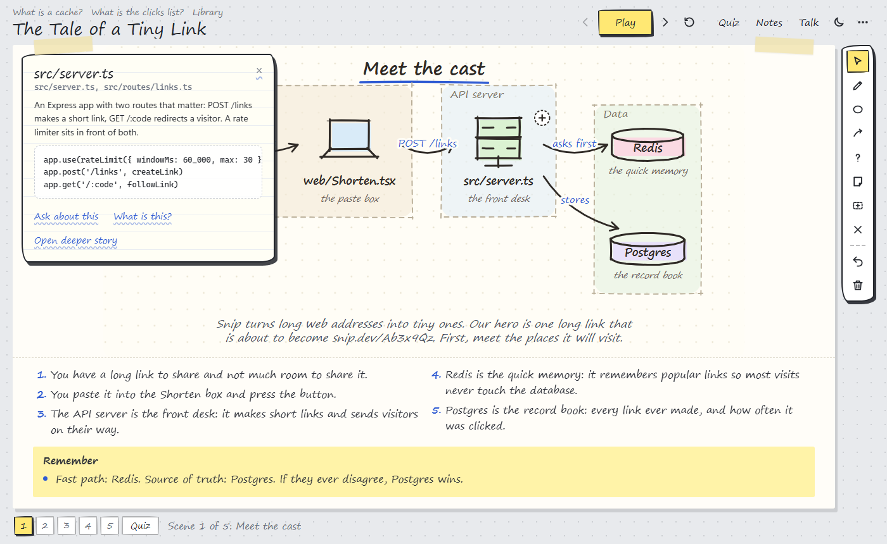
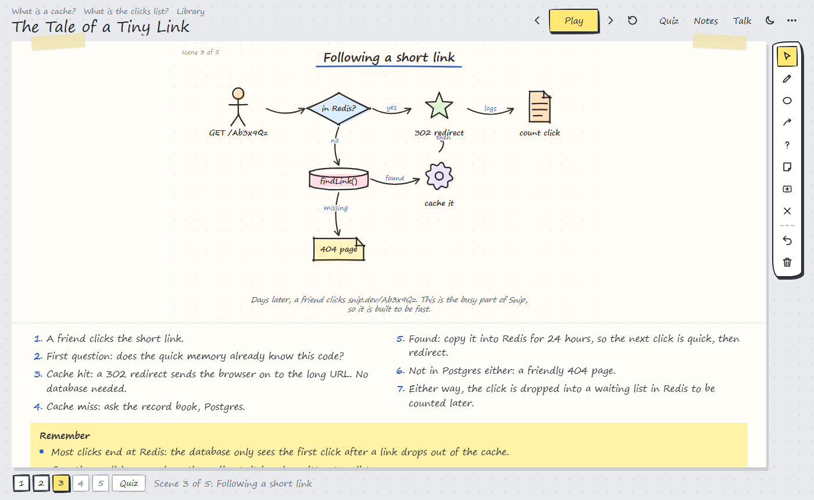
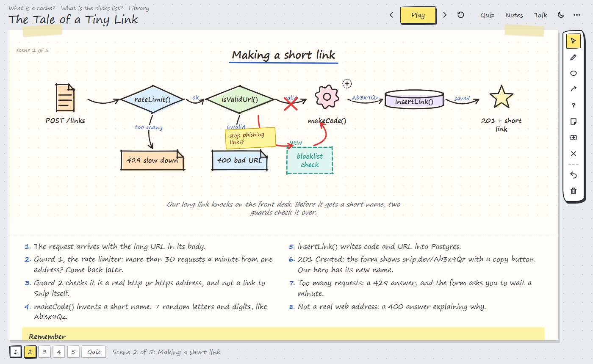
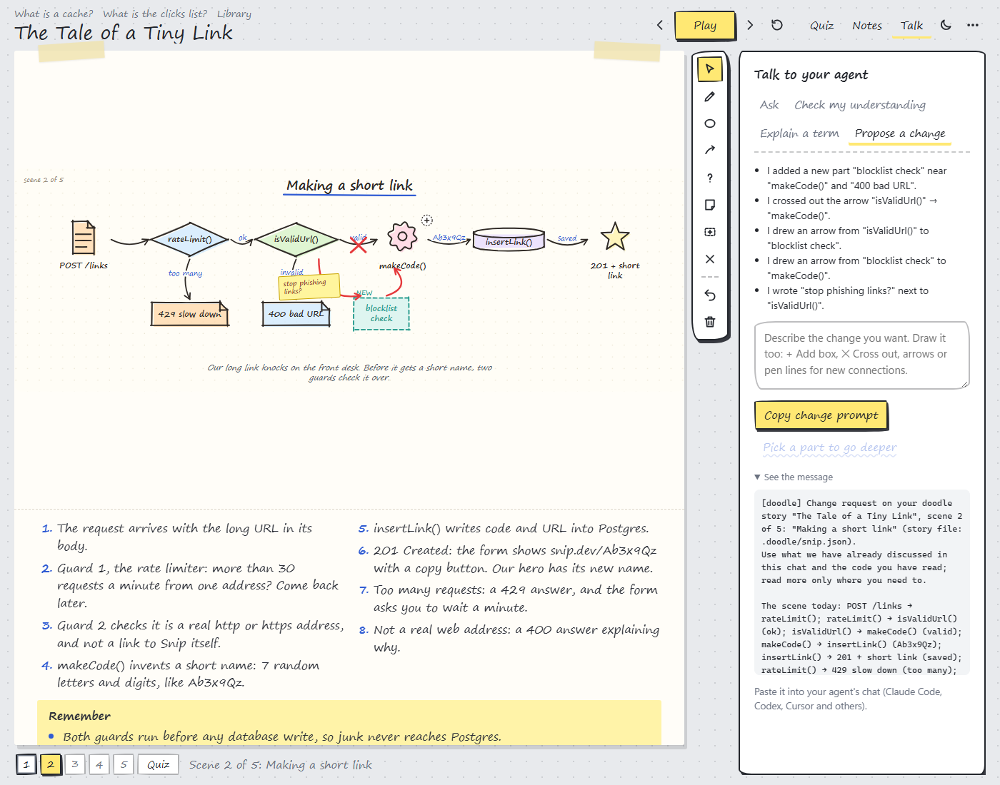
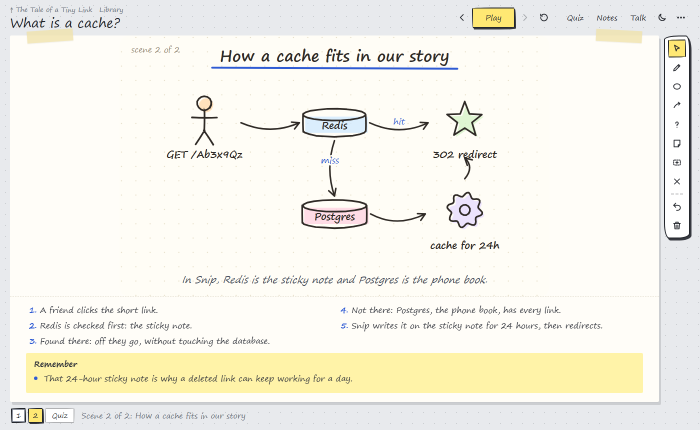
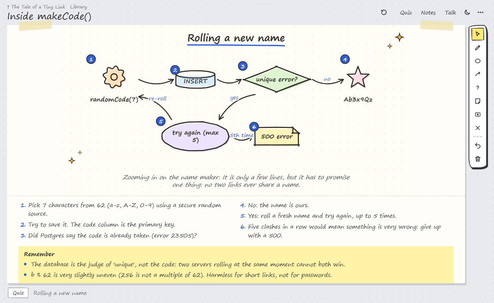
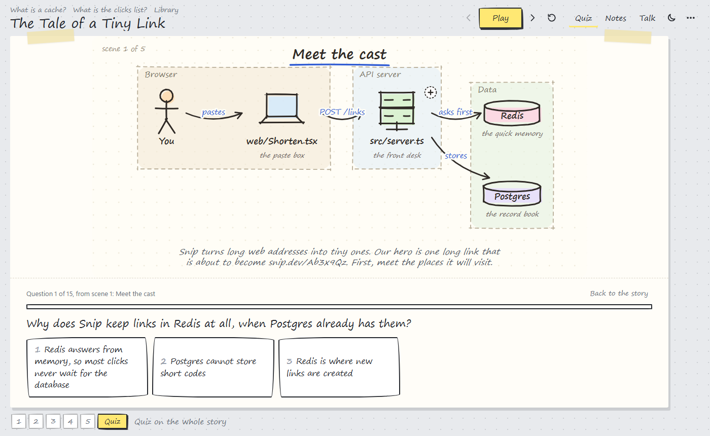
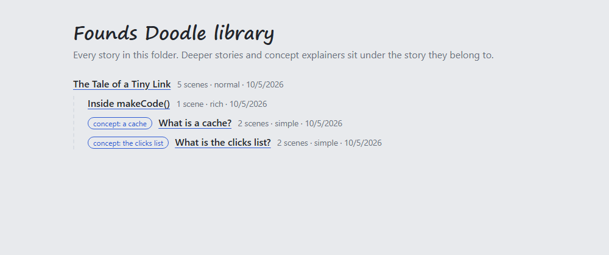

# Founds Doodle

**A doodle way of learning.** Your codebase, told as an animated, hand-drawn storybook that you and your AI agent learn from together.

Founds Doodle is an agent skill for **Claude Code**, **Codex**, **Cursor**, **Antigravity** and any agent that reads `SKILL.md`. Ask your agent to explain a project, a flow or an idea. It reads the code and writes a short story in scenes, following one "hero" (a request, a file, a job) through your code. The story opens as a sketchbook page where you can **play it, draw on it, take notes, take a quiz, ask what a word means, and even sketch the change you want made**.



> "Use founds-doodle to make a story of how my codebase works. Keep it high level."
> "Doodle the payments module in depth."
> "Zoom into the queue and go step by step."

No image model, no API keys, no packages. Just Node 18 or newer.

## Why

Reading an unfamiliar codebase is slow, and a wall of text in chat is easy to nod along to and hard to remember. Founds Doodle turns it into something you can *see*, *poke at* and *argue with*:

1. **See it**: a story in scenes, from the big picture down to a single function.
2. **Draw on it**: circle what confuses you, draw where you think data goes, cross out what you'd remove.
3. **Talk it through**: your drawing becomes a precise message to your agent. It answers, corrects you (or admits you're right), quizzes you, and explains words you don't know.
4. **Test it**: a quick tap-to-answer quiz at the end shows what stuck and what didn't.
5. **Keep it**: what you settle together is written into the story as notes, so you can review it later or share it with your team.

## A tour

The screenshots use the example in [`examples/`](examples/): **Snip**, a tiny URL shortener (Express, Redis, Postgres and a background job). Our hero is one long link on its way to becoming `snip.dev/Ab3x9Qz`.

### 1. A story that follows a hero

Each scene draws itself in: parts appear one by one, arrows follow, and numbered captions underneath tell the story as the pen moves. Zones show where each part lives. A **Remember** box ends the scene.


### 2. Click any part to learn it

A card explains the part in plain words, with its real file and a short excerpt of its real code.



### 3. Flows, branches and loops

Decisions, cache hits and misses, error paths: the main path stays on one line and the side exits sit underneath.



### 4. Sketch a change

Draw the design you want: **+ Add box** for a new part, **✕ Cross out** for an arrow or a part to remove, arrows or pen lines for new connections, notes for what you mean.



### 5. ...and get a ready-made prompt

**Propose a change** turns the drawing into numbered edits. Your agent already knows the code from the chat, so it maps the edits to files, shows you a plan, **waits for your OK**, makes the change and updates the story.



### 6. "What is a cache?"

**Explain a term** asks for a small concept story: the idea from zero with an everyday comparison, then a last scene showing exactly where it sits in *your* story.



### 7. Zoom in

Parts with a ⊕ have a deeper story. Here, how `makeCode()` guarantees that no two links share a name.



### 8. A quiz at the end

**★ Quiz** tests you on the whole story, and every answer is a tap. It mixes questions made from the drawing (which part does this, what comes next, put the steps in order, name the hidden part) with "why" questions the agent wrote into each scene. You get a score per scene, the reasons behind what you missed, **Retry the ones I missed**, and **Ask the agent about my misses**.



### 9. A library to come back to

Every story lives in `.doodle/` in your project with an `index.html` library. Deeper stories and concept stories nest under the story they came from.



## Look and feel

A sketchbook on a desk: the story is a sheet of paper taped down, the tools are an inked rail beside it, scenes are a numbered track, and Notes and Talk slide in only when you open them. The ☾ button switches between **light and dark** (it starts from your system setting and remembers your choice). Keyboard: `←` `→` scenes, `Space` play, `R` replay, `P` pen, `N` notes, `T` talk.

## Any depth

| Level | Ask for | You get |
| --- | --- | --- |
| Elevator pitch | "in a nutshell", "one picture" | 1 scene |
| Overview | "high level", "quick" | 2 scenes: the big picture and the main flow |
| Walkthrough | "explain this" (default) | 3-5 scenes |
| Deep dive | "in depth", "everything" | 5-10 scenes, notes, code on every part, numbered steps |
| Part story | "zoom into X" | a new story about X, linked from its parent |
| Function level | "step by step", "what exactly happens in f()" | one scene per function or branch, with real checks, data and error paths |

## Talk to your agent

| Mode | What happens |
| --- | --- |
| **Ask** | Ask about the scene. Your drawing goes with the question. |
| **Check my understanding** | Explain the scene in your own words. The agent says what's right, corrects what's wrong, and fills in what you missed. |
| **Explain a term** | "What is an API?" The agent makes a concept story that ends inside your story. |
| **Propose a change** | Draw the design you want and get a ready-made change prompt (see the tour). |

What you and the agent settle shows up under **What we figured out** in the scene's notebook, next to your own notes.

### Live: the page talks to your agent directly

When your agent can keep a command running (Claude Code can, in the background), it starts a small local server and the page gets a **Send to agent** button:

- you press **Send to agent**, and your message, drawing included, goes straight to the agent;
- the page answers what it can **right away** from the story itself (ask "what does Redis do?" and you instantly get the story's own explanation of Redis), and shows **"your agent is working on it"** until the full answer arrives;
- the agent answers in your chat **and** in a chat thread on the page;
- when the agent updates the story (a correction, a note you agreed on), the page reloads by itself and keeps your drawings and notes.

Everything stays on your computer: the server only listens on `127.0.0.1`. Without live mode, press **Copy** and paste the message into your agent's chat instead (**Save picture** gives you a PNG to attach as well). Same message, same answers.

## Install

You need **Node 18 or newer** (the skill runs a small script to draw the story) and a web browser. No API keys, no packages.

### One command, any agent

```bash
npx skills add Foundwastaken/founds-doodle
```

This uses the open [skills CLI](https://github.com/vercel-labs/skills), which works with Claude Code, Codex, Cursor, Gemini CLI, GitHub Copilot and more. It asks which agents to install for. Add `-g` to install for your user instead of just this project, or `-a <agent>` to pick one (for example `-a codex`).

### Or copy the folder by hand

Download the repo, then copy the `skills/founds-doodle` folder into your agent's skills folder:

```bash
git clone https://github.com/Foundwastaken/founds-doodle.git
```

| Agent | All your projects | One project only |
| --- | --- | --- |
| **Claude Code** | `~/.claude/skills/founds-doodle` | `.claude/skills/founds-doodle` |
| **Codex** | `~/.codex/skills/founds-doodle` (or `$CODEX_HOME/skills`) | `.codex/skills/founds-doodle` |
| **Cursor** | `~/.cursor/skills/founds-doodle` | `.cursor/skills/founds-doodle` |
| **Antigravity** | `~/.gemini/antigravity/skills/founds-doodle` | `.agents/skills/founds-doodle` |
| **Other agents** | `~/.agents/skills/founds-doodle` | `.agents/skills/founds-doodle` |

For example, on macOS or Linux:

```bash
mkdir -p ~/.claude/skills && cp -R founds-doodle/skills/founds-doodle ~/.claude/skills/
```

On Windows (PowerShell):

```powershell
New-Item -ItemType Directory -Force "$HOME\.claude\skills" | Out-Null
Copy-Item -Recurse founds-doodle\skills\founds-doodle "$HOME\.claude\skills\"
```

Swap `.claude` for `.codex`, `.cursor` and so on. Cursor also reads skills from the Claude Code and Codex folders, so one copy can serve all three.

### Use it

Open your project in your agent and ask in plain words:

> "Use founds-doodle to tell the story of how this codebase works."

Or call it directly: `/founds-doodle` in Claude Code and Cursor, `$founds-doodle` in Codex. Most agents also pick it up on their own when you ask for a doodle, a story or a visual walkthrough.

If an agent cannot run Node, the skill falls back to telling the story in chat, with one small Mermaid diagram per scene.

### Update

Run `npx skills add Foundwastaken/founds-doodle` again, or `git pull` and copy the folder again.

## How it works

```
you ask ──> agent reads the code ──> .doodle/<id>.json ──> scripts/doodle.mjs ──> .doodle/<id>.html  (+ index.html)
                                                                                      │
   agent answers, corrects, quizzes,  <── [doodle] message you paste <── you draw, take notes, ask
   changes code, writes notes into the story ──> rebuild ──> your notebook shows what you learned
```

| File | Job |
| --- | --- |
| `skills/founds-doodle/SKILL.md` | Tells the agent how to pick the depth, explore the code, tell a good story, and run the learning loop. |
| `skills/founds-doodle/scripts/doodle.mjs` | Checks the story JSON and builds the self-contained HTML pages and the library index. |
| `skills/founds-doodle/scripts/core.js` | Lays out each scene and draws it as SVG with SMIL animation. The agent writes a small JSON story and never draws pixels or writes markup. |
| `skills/founds-doodle/scripts/player.html` | The page: scenes, drawing tools, notebook and talk panel. |
| `skills/founds-doodle/scripts/live.mjs` | Live mode: the local server (`serve`), and the agent's `listen` and `reply` commands. |
| `skills/founds-doodle/references/story-format.md` | The story format. |
| `skills/founds-doodle/agents/openai.yaml` | How the skill shows up in Codex. |

Try it by hand with the example:

```bash
node skills/founds-doodle/scripts/doodle.mjs examples/snip.json --open
```

Handy links: add `#scene=3` to a story's address to open a scene, `#focus` to hide the side panel, `#card=<part id>` to open a part's card.

## Privacy

Everything runs locally. The pages make no requests to the internet, and nothing is sent anywhere. In live mode the page talks only to the small server your agent started on `127.0.0.1` (this computer); otherwise it reaches your agent only through what you copy and paste. Your drawings and notes stay in your browser (`localStorage`) unless you press **Save my copy**; live conversations are kept in `.doodle/talk.jsonl` in your project.

## Big codebases

There is no small cap on scenes or parts: a story is as long as its journey, from 1 scene to dozens. Long paths fold back and forth across the page so big scenes stay readable. For a large codebase the skill builds a library instead of one giant story: an overview, then a linked part story per subsystem, as deep as you want to go.

## Good to know

- Live mode needs an agent that can keep a command running (Claude Code can). Other agents use copy and paste, with the same messages and answers.
- Pen strokes are read relative to the parts: loops, lines, marks. A loop drawn around empty space asks for a name and becomes a new part.

## License

MIT
